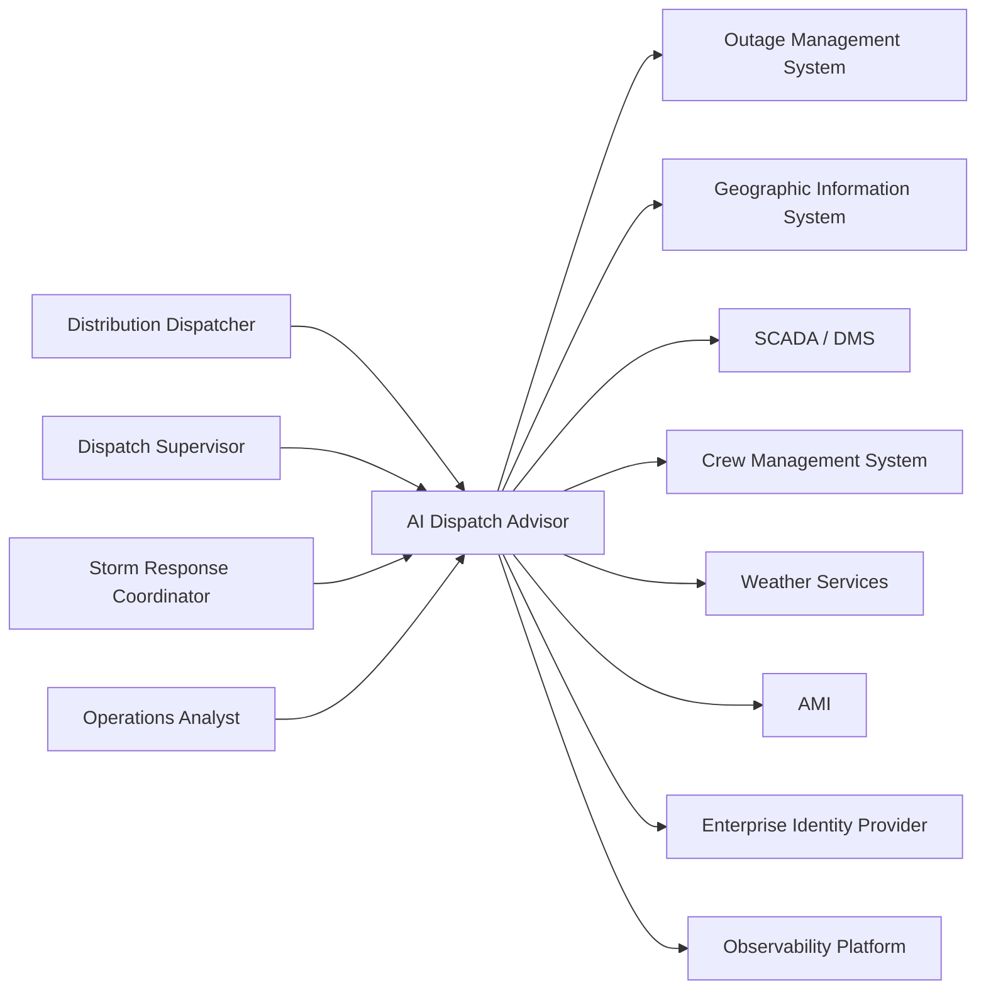

# System Context

## Purpose

This document defines the system context for the AI Dispatch Advisor. It identifies the system boundary, primary users, external systems, major data flows, and current implementation state.

The AI Dispatch Advisor is an enterprise outage dispatch decision-support system for electric utilities. It is intended to sit beside existing operational systems and help users evaluate outage events, crew options, dispatch recommendations, and recommendation explanations.

## Current Implementation State

The current repository includes a Developer Bootstrap MVP. It is a runnable proof-of-concept foundation with:

- React and TypeScript frontend.
- FastAPI backend.
- Synthetic CSV demo data.
- Initial SQLite schema and database initialization script.
- API endpoints for dashboard, incidents, crews, assignments, optimization, and copilot responses.
- Docker Compose and GitHub Actions baseline.

The current implementation does not yet include production authentication, production persistence, real source-system integrations, real AI model integration, or autonomous dispatch execution.

## System Boundary

The AI Dispatch Advisor includes:

- User-facing dispatch console.
- Backend API service.
- Recommendation and optimization logic.
- Data loading and domain transformation services.
- Audit and recommendation history model, planned for later implementation.
- Integration adapters, planned for later implementation.

The AI Dispatch Advisor does not replace:

- Outage Management System.
- Geographic Information System.
- SCADA or Distribution Management System.
- Crew or workforce management system.
- Customer communication platforms.
- Grid control systems.

## Primary Actors

| Actor | Relationship to System |
| --- | --- |
| Distribution Dispatcher | Reviews incidents, evaluates recommendations, and approves or overrides dispatch actions |
| Dispatch Supervisor | Monitors outage operations, crew utilization, escalations, and recommendation patterns |
| Storm Response Coordinator | Uses storm mode views and scenario comparison during major events |
| Operations Analyst | Reviews historical recommendations, overrides, outcomes, and data quality issues |
| Utility IT Administrator | Operates environments, integrations, access configuration, and support workflows |
| Security and Compliance Reviewer | Reviews auditability, access control, data handling, and operational traceability |

## External Systems

| External System | Target Role |
| --- | --- |
| OMS | Source of outage events, outage status, customer impact, restoration status, and dispatch actions |
| GIS | Source of asset, feeder, circuit, topology, facility, and geospatial context |
| SCADA or DMS | Source of telemetry, device state, alarms, switching context, and operational constraints |
| Crew Management System | Source of crew availability, assignments, skills, shifts, and workforce status |
| Weather Services | Source of weather conditions, storm warnings, wind, precipitation, and hazard context |
| AMI | Source of meter outage and restoration signals where available |
| Identity Provider | Source of user authentication, roles, groups, and enterprise access policy |
| Observability Platform | Target for logs, metrics, traces, alerts, and operational diagnostics |

## Context Diagram



## Current POC Context

In the Developer Bootstrap MVP, external systems are simulated by synthetic files under:

```text
data/scenarios/base/
```

The backend reads these CSV files and exposes them through API endpoints. Recommendation logic is deterministic and local. The AI Copilot is a keyword-based advisory demo endpoint, not an LLM-backed assistant.

## Target Enterprise Context

In the target enterprise architecture:

- OMS, GIS, SCADA, crew, AMI, and weather systems will be integrated through adapters.
- The backend will normalize source data into domain objects used by recommendation services.
- Users will authenticate through enterprise identity.
- Recommendations will include structured explainability and auditable decision records.
- Accepted dispatch actions may be written back to approved systems of record when integration contracts allow it.
- Audit, observability, security, and operational controls will be first-class system capabilities.

## Key Context Assumptions

- The system initially acts as a decision-support layer, not a system of record.
- Human approval remains required for dispatch decisions.
- Production integrations will vary by utility and must be adapter-based.
- Data quality, freshness, and source confidence materially affect recommendation trust.
- The product must support routine outage operations and major event conditions.

## Out of Scope Context

The system context excludes:

- Direct grid device control.
- Fully autonomous crew dispatch.
- Replacement of OMS, GIS, SCADA, DMS, AMI, or workforce systems.
- Customer-facing outage communication workflows.
- Production regulatory certification.

## Related Documents

- [Solution Architecture](202_Solution_Architecture.md)
- [Component Architecture](203_Component_Architecture.md)
- [Integration Architecture](204_Integration_Architecture.md)
- [Data Flow Architecture](205_Data_Flow_Architecture.md)
- [Deployment Architecture](206_Deployment_Architecture.md)

