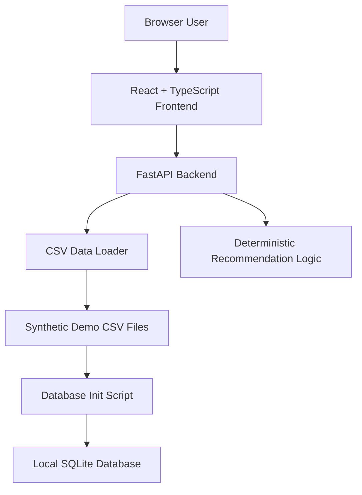
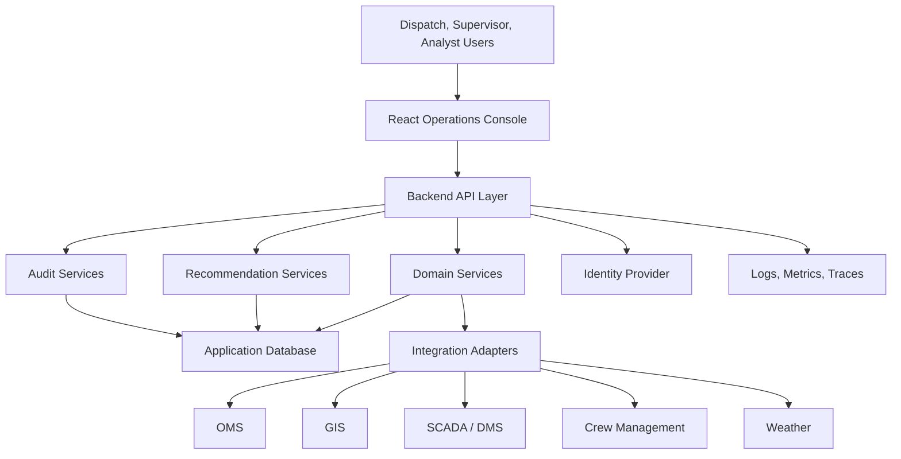

# Solution Architecture

## Purpose

This document describes the overall solution architecture for the AI Dispatch Advisor. It explains the major architectural layers, current Developer Bootstrap MVP implementation, target enterprise direction, and principal architectural decisions.

## Architecture Summary

The AI Dispatch Advisor uses a layered web application architecture:

- React frontend for operational users.
- FastAPI backend for API orchestration and domain services.
- Recommendation services for dispatch prioritization, crew suitability, and explanation.
- Data layer for demo CSV data and planned persistent domain storage.
- Integration layer for future OMS, GIS, SCADA, crew, weather, and identity integrations.
- Operations layer for CI, Docker, observability, security, and deployment practices.

## Current Solution View

The current MVP provides the first runnable product shell. It supports local review of the product concept and demonstrates frontend-to-backend data flow.

## Target Solution View

## Architectural Layers

### Presentation Layer

The presentation layer is the React frontend. It provides:

- Operational dashboard.
- Dispatch queue.
- Incident views.
- Crew board.
- Storm mode.
- Scenario comparison.
- AI Copilot panel.
- Recommendation review and action controls.

Current implementation:

- `frontend/src/App.tsx`
- `frontend/src/api.ts`
- `frontend/src/types.ts`
- `frontend/src/styles.css`

Target direction:

- Introduce route-level pages and shared components as the UI grows.
- Add state management only when local component state becomes insufficient.
- Add production design system and accessibility review.

### API Layer

The API layer is the FastAPI backend. It provides:

- REST API endpoints.
- CORS support for local frontend development.
- Request validation using Pydantic models.
- Orchestration between data loaders and recommendation logic.

Current implementation:

- `backend/app/main.py`

Target direction:

- Split routers by domain.
- Add authentication and authorization middleware.
- Define OpenAPI contracts as reviewable API artifacts.
- Separate request handlers from domain services.

### Domain and Recommendation Layer

The domain and recommendation layer handles dispatch-specific logic:

- Incident ranking.
- Crew suitability.
- Recommendation explanation.
- Scenario comparison.
- Planned audit event generation.

Current implementation:

- `backend/app/recommendations.py`

Target direction:

- Separate deterministic optimization from AI-assisted narrative generation.
- Introduce explicit recommendation objects and explanation schemas.
- Add test coverage for recommendation cases and edge conditions.

### Data Layer

The data layer currently consists of synthetic CSV files and an optional SQLite database initialization script.

Current implementation:

- `data/scenarios/base/*.csv`
- `database/schema.sql`
- `database/seed.sql`
- `scripts/init_db.py`

Target direction:

- Use a persistent database for application state.
- Track recommendation history and audit events.
- Model source data freshness and integration provenance.
- Support multiple demo and test scenarios.

### Integration Layer

The integration layer is planned but not yet implemented. It will isolate enterprise source systems from the application domain.

Target integration domains:

- OMS.
- GIS.
- SCADA or DMS.
- Crew or workforce management.
- Weather services.
- AMI.
- Identity provider.

The integration layer should use adapters so vendor-specific protocols and schemas do not leak into the domain model.

### Operations Layer

The operations layer includes local development, CI, container startup, testing, and future production deployment support.

Current implementation:

- `docker-compose.yml`
- `.github/workflows/ci.yml`
- `backend/Dockerfile`
- `scripts/bootstrap_dev.sh`

Target direction:

- Add environment-specific configuration.
- Add observability and structured logging.
- Add production deployment architecture.
- Add secrets management practices.

## Architecture Decisions Reflected

The current solution reflects these accepted decisions:

- React frontend.
- FastAPI backend.
- Human-in-the-loop recommendations.
- Explainability by default.
- Enterprise integrations as first-class architecture concerns.
- Operational workflow before automation depth.

See `docs/001_Decision_Log.md` for decision history.

## Current Limitations

The MVP intentionally does not yet include:

- Production authentication or roles.
- Production database-backed API state.
- Real optimization engine.
- LLM-backed AI Copilot.
- Persistent recommendation actions.
- Integration adapters.
- Audit history API.
- Deployment beyond local Docker and CI baseline.

## Architectural Risks

| Risk | Impact | Mitigation |
| --- | --- | --- |
| Demo logic becomes production logic accidentally | Weak production readiness | Keep POC boundaries documented and refactor into services before production use |
| Source-system variability | Integration delays | Use adapter contracts and source data normalization |
| Opaque recommendation logic | Low user trust | Require structured explanation outputs |
| UI grows as one large component | Maintainability risk | Split into route pages and components in next frontend iteration |
| Data quality is hidden | Incorrect user confidence | Track data freshness, missing fields, and source status |

## Related Documents

- [System Context](201_System_Context.md)
- [Component Architecture](203_Component_Architecture.md)
- [Integration Architecture](204_Integration_Architecture.md)
- [Data Flow Architecture](205_Data_Flow_Architecture.md)
- [Deployment Architecture](206_Deployment_Architecture.md)

