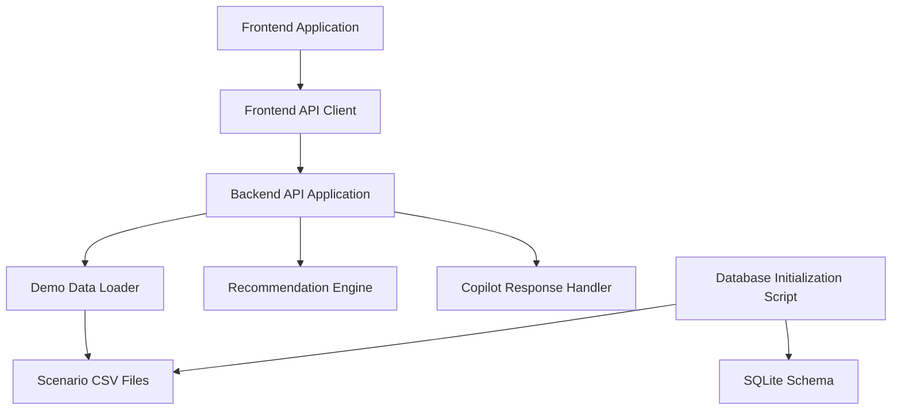

# Component Architecture

## Purpose

This document describes the major components of the AI Dispatch Advisor, their responsibilities, current implementation locations, and target evolution.

## Component Overview

## Current Components

### Frontend Application

Location:

- `frontend/src/App.tsx`
- `frontend/src/styles.css`

Responsibilities:

- Render the operations console shell.
- Provide navigation between dashboard, dispatch, incidents, crew board, storm mode, scenario, and copilot views.
- Display dashboard metrics and incident queues.
- Display selected recommendation details.
- Provide placeholder recommendation action controls.
- Display Copilot prompt buttons and advisory responses.

Current limitations:

- Most UI is currently contained in a single React component.
- Recommendation actions are visible but not persisted.
- There is no route library yet.
- There is no production design system yet.

Target evolution:

- Split views into route-level page components.
- Extract reusable tables, panels, metrics, recommendation cards, and action controls.
- Add state management if cross-page state becomes complex.
- Add accessibility and responsive layout QA.

### Frontend API Client

Location:

- `frontend/src/api.ts`

Responsibilities:

- Encapsulate backend API calls.
- Provide typed fetch helpers.
- Use `VITE_API_BASE_URL` or local default backend URL.

Current limitations:

- No retry logic.
- No request cancellation.
- No authenticated requests.
- No generated client from OpenAPI.

Target evolution:

- Centralize API error handling.
- Add typed API contracts aligned with backend schemas.
- Consider OpenAPI-generated types after API stabilizes.
- Add authentication headers when identity integration is introduced.

### Frontend Types

Location:

- `frontend/src/types.ts`

Responsibilities:

- Define TypeScript types for incidents, crews, assignments, dashboard summaries, and recommendations.

Current limitations:

- Types are manually maintained.
- Types are not yet generated from backend OpenAPI schemas.

Target evolution:

- Align frontend types with backend response models.
- Add API schema validation tests or generated type artifacts.

### Backend API Application

Location:

- `backend/app/main.py`

Responsibilities:

- Create the FastAPI application.
- Configure CORS for local development.
- Expose health and demo API endpoints.
- Orchestrate data loading and recommendation responses.

Current endpoints:

- `GET /health`
- `GET /api/dashboard`
- `GET /api/incidents`
- `GET /api/incidents/{incident_id}`
- `GET /api/crews`
- `GET /api/assignments`
- `GET /api/weather`
- `GET /api/critical-facilities`
- `GET /api/topology`
- `POST /api/optimize`
- `POST /api/chat`

Current limitations:

- API routers are not yet split by domain.
- Response models are not fully declared.
- Authentication and authorization are not implemented.
- API state is not persistent.

Target evolution:

- Split routers into incidents, crews, recommendations, scenarios, audit, and integrations.
- Add explicit Pydantic response models.
- Add service classes or modules for domain behavior.
- Add authentication and role checks.

### Demo Data Loader

Location:

- `backend/app/data_loader.py`

Responsibilities:

- Locate the active demo scenario.
- Read CSV files from `data/scenarios/base/`.
- Coerce basic CSV values into booleans, integers, floats, or strings.
- Cache loaded CSV data.

Current limitations:

- Scenario selection is backend environment-based only.
- There is no runtime scenario switcher.
- CSV validation is minimal.

Target evolution:

- Add scenario manifest files.
- Validate required columns and data types.
- Support multiple named scenarios.
- Add endpoint for available scenarios.

### Recommendation Engine

Location:

- `backend/app/recommendations.py`

Responsibilities:

- Rank incidents.
- Calculate basic crew suitability.
- Return recommendation objects with explanation factors and constraints.
- Produce dashboard summary metrics.

Current limitations:

- Logic is deterministic and simplified.
- Scoring is illustrative, not operationally validated.
- No OR-Tools, NetworkX, or advanced optimization is implemented yet.
- No persisted recommendation event is created.

Target evolution:

- Separate incident priority scoring, crew matching, scenario comparison, and explanation generation.
- Add optimization libraries when the data model supports them.
- Add test cases for known dispatch scenarios.
- Persist recommendation requests and outcomes.

### Copilot Response Handler

Location:

- `backend/app/main.py`

Responsibilities:

- Return simple advisory responses based on keyword intent.
- Summarize synthetic dispatch data.
- Maintain a clear safety boundary that Copilot responses do not execute dispatch actions.

Current limitations:

- Not connected to an LLM.
- No retrieval layer.
- No conversation memory beyond frontend display.
- No policy or prompt framework.

Target evolution:

- Add a controlled AI service boundary.
- Use structured domain context retrieval.
- Keep dispatch action execution separate from advisory language generation.
- Add audit and safety controls for AI-generated content.

### Database Initialization Script

Location:

- `scripts/init_db.py`

Responsibilities:

- Create `database/aida.db` locally.
- Apply `database/schema.sql`.
- Load selected CSV files into initial SQLite tables.

Current limitations:

- The backend does not yet read from SQLite.
- Database generation is local development support only.

Target evolution:

- Move backend data access to database-backed repositories.
- Support migrations.
- Track audit events and recommendation history.

## Planned Components

The following components are planned but not yet implemented:

| Component | Responsibility |
| --- | --- |
| Audit Service | Persist recommendation, user action, override, and integration events |
| Scenario Service | Manage demo and operational scenario comparisons |
| Integration Adapters | Normalize OMS, GIS, SCADA, crew, weather, and AMI source data |
| Identity Adapter | Integrate with enterprise authentication and role claims |
| Optimization Service | Run dispatch, crew, and restoration optimization logic |
| Model Governance Service | Track AI model versions, prompt versions, and evaluation metadata |
| Observability Middleware | Emit structured logs, metrics, traces, and correlation identifiers |

## Component Boundaries

The following boundaries should be preserved as implementation grows:

- Frontend components should not encode backend scoring rules.
- API handlers should delegate complex logic to services.
- Integration adapters should not leak vendor-specific schemas into UI components.
- Recommendation logic should return structured explanations, not only display text.
- Copilot language generation should not directly execute operational actions.
- Database persistence should be accessed through backend services, not frontend code.

## Related Documents

- [System Context](201_System_Context.md)
- [Solution Architecture](202_Solution_Architecture.md)
- [Integration Architecture](204_Integration_Architecture.md)
- [Data Flow Architecture](205_Data_Flow_Architecture.md)

