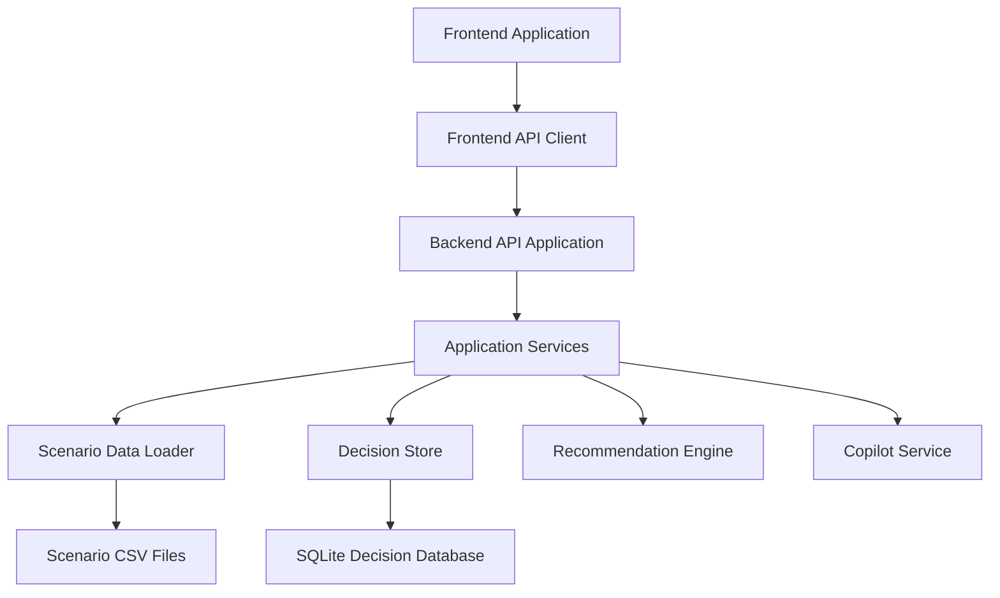

# Component Architecture

## Purpose

This document describes the major components of the AI Dispatch Advisor, their responsibilities, current implementation locations, and target evolution.

## Component Overview

## Current Components

### Frontend Application

Location:

- `frontend/src/App.tsx`
- `frontend/src/styles.css`

Responsibilities:

- Render the operations console shell.
- Provide navigation between dashboard, dispatch, incidents, crew board, storm mode, scenario, and copilot views.
- Display dashboard metrics and incident queues.
- Display selected recommendation details.
- Capture Accept, Modify, Defer, and Override actions with required reasons.
- Display Copilot prompt buttons and advisory responses.

Current limitations:

- Most UI is currently contained in a single React component.
- Recommendation actions are visible but not persisted.
- There is no route library yet.
- There is no production design system yet.

Target evolution:

- Split views into route-level page components.
- Extract reusable tables, panels, metrics, recommendation cards, and action controls.
- Add state management if cross-page state becomes complex.
- Add accessibility and responsive layout QA.

### Frontend API Client

Location:

- `frontend/src/api.ts`

Responsibilities:

- Encapsulate backend API calls.
- Provide typed fetch helpers.
- Use `VITE_API_BASE_URL` or local default backend URL.

Current limitations:

- No retry logic.
- No request cancellation.
- No authenticated requests.
- No generated client from OpenAPI.

Target evolution:

- Centralize API error handling.
- Add typed API contracts aligned with backend schemas.
- Consider OpenAPI-generated types after API stabilizes.
- Add authentication headers when identity integration is introduced.

### Frontend Types

Location:

- `frontend/src/types.ts`

Responsibilities:

- Define TypeScript types for incidents, crews, assignments, dashboard summaries, and recommendations.

Current limitations:

- Types are manually maintained.
- Types are not yet generated from backend OpenAPI schemas.

Target evolution:

- Align frontend types with backend response models.
- Add API schema validation tests or generated type artifacts.

### Backend API Application

Location:

- `backend/app/main.py`

Responsibilities:

- Create the FastAPI application.
- Configure CORS for local development.
- Expose health and demo API endpoints.
- Validate requests and responses through explicit Pydantic contracts.
- Delegate operational behavior to application services.
- Map service errors to the current HTTP response behavior.

Current endpoints:

- `GET /health`
- `GET /api/dashboard`
- `GET /api/incidents`
- `GET /api/incidents/{incident_id}`
- `GET /api/crews`
- `GET /api/assignments`
- `GET /api/weather`
- `GET /api/critical-facilities`
- `GET /api/topology`
- `POST /api/optimize`
- `POST /api/recommendation-actions`
- `GET /api/audit/events`
- `GET`, `PUT /api/scenarios/*`
- `POST /api/chat`

Current limitations:

- API routers are not yet split by domain.
- Supporting context response models are not fully declared.
- Authentication and authorization are not implemented.
- Request correlation is not yet connected to centralized structured logs or traces.

Target evolution:

- Split routers into incidents, crews, recommendations, scenarios, audit, and integrations.
- Complete supporting-context response contracts.
- Keep HTTP routing separate from application-service behavior.
- Add authentication and role checks.

### Demo Data Loader

Location:

- `backend/app/data_loader.py`

Responsibilities:

- Locate the active demo scenario.
- Read CSV files from the active manifested scenario directory.
- Coerce basic CSV values into booleans, integers, floats, or strings.
- Cache loaded CSV data.

Current limitations:

- Scenario activation remains process-global for the local backend.
- Scenario data remains a POC adapter rather than an enterprise integration.

Target evolution:

- Replace or complement scenario inputs with normalized enterprise adapters.
- Preserve the current domain contracts when source systems change.

### Recommendation Engine

Location:

- `backend/app/recommendations.py`

Responsibilities:

- Rank incidents.
- Calculate basic crew suitability.
- Return recommendation objects with explanation factors and constraints.
- Produce dashboard summary metrics.

Current limitations:

- Logic is deterministic and simplified.
- Scoring is illustrative, not operationally validated.
- No OR-Tools, NetworkX, or advanced optimization is implemented yet.
- Recommendation generation is not persisted separately until a user action is recorded.

Target evolution:

- Separate incident priority scoring, crew matching, scenario comparison, and explanation generation.
- Add optimization libraries when the data model supports them.
- Add test cases for known dispatch scenarios.
- Persist recommendation requests and outcomes.

### Application Services

Location:

- `backend/app/services/`

Responsibilities:

- Compose incident, crew, assignment, recommendation, decision, scenario, and operational-context state.
- Merge immutable scenario inputs with mutable decision and accepted-assignment overlays.
- Return typed domain and API models.
- Keep API handlers free of domain-state composition.
- Provide Copilot advisory responses through the same current-state services.

Current limitations:

- Current adapters are wired through a local composition root rather than repository interfaces.
- Service execution is synchronous and local.
- Copilot remains keyword-based and is not connected to an LLM or retrieval layer.

Target evolution:

- Add repository interfaces for mutable persistence.
- Add enterprise integration adapters behind the service contracts.
- Split HTTP routes into domain routers without moving business behavior back into the API layer.
- Add a controlled AI boundary while keeping dispatch execution separate from advisory output.

### Decision Store

Location:

- `backend/app/decision_store.py`

Responsibilities:

- Persist scenario-scoped recommendation decisions and audit history.
- Persist accepted assignments that overlay immutable scenario assignments.
- Run ordered, checksummed SQL migrations at application startup.
- Record applied versions in `schema_migrations`.

Current limitations:

- SQLite is intended for local POC operation, not multi-user production deployment.
- Automated downgrade migrations and production backup procedures are not implemented.

Target evolution:

- Introduce repository interfaces and production migration operations.
- Replace SQLite with an enterprise-approved relational database for production deployment.

## Planned Components

The following components are planned but not yet implemented:

| Component | Responsibility |
| --- | --- |
| Production Audit Service | Extend current recommendation-action history to system, security, and integration events |
| Scenario Comparison Service | Compare modeled operational alternatives beyond current scenario activation |
| Integration Adapters | Normalize OMS, GIS, SCADA, crew, weather, and AMI source data |
| Identity Adapter | Integrate with enterprise authentication and role claims |
| Optimization Service | Run dispatch, crew, and restoration optimization logic |
| Model Governance Service | Track AI model versions, prompt versions, and evaluation metadata |
| Observability Middleware | Emit structured logs, metrics, traces, and correlation identifiers |

## Component Boundaries

The following boundaries should be preserved as implementation grows:

- Frontend components should not encode backend scoring rules.
- API handlers should delegate complex logic to services.
- Integration adapters should not leak vendor-specific schemas into UI components.
- Recommendation logic should return structured explanations, not only display text.
- Copilot language generation should not directly execute operational actions.
- Database persistence should be accessed through backend services, not frontend code.

## Related Documents

- [System Context](201_System_Context.md)
- [Solution Architecture](202_Solution_Architecture.md)
- [Integration Architecture](204_Integration_Architecture.md)
- [Data Flow Architecture](205_Data_Flow_Architecture.md)
