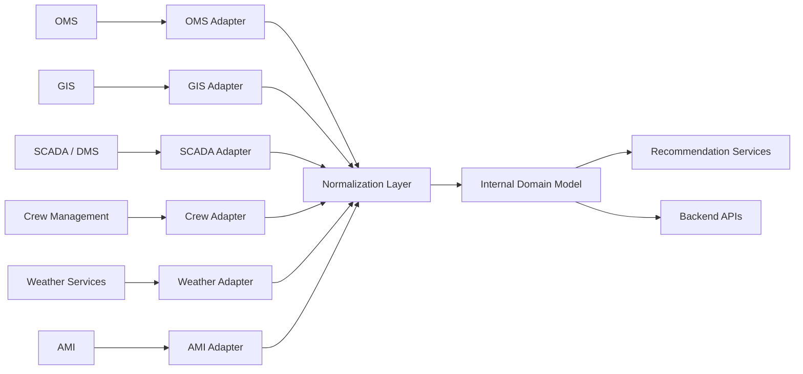

# Integration Architecture

## Purpose

This document defines the integration architecture for the AI Dispatch Advisor. It describes how the system should connect to utility enterprise platforms while preserving modularity, security, data quality, and operational resilience.

## Current Implementation State

The Developer Bootstrap MVP does not include live enterprise integrations. It simulates source systems with synthetic CSV files under:

```text
data/scenarios/base/
```

These files represent outage events, crews, assignments, weather, critical facilities, historical repairs, and topology context.

Phase 7 will introduce the adapter boundary incrementally. Work should begin with the discovery and feedback gate defined in `docs/900_Delivery/907_Phase_7_Implementation_Plan.md`; the first enterprise vertical slice remains read-only and must be selected from an identified source owner, contract or sample payload, and operational freshness requirements.

## Integration Goals

The integration architecture should:

- Isolate vendor-specific systems through adapters.
- Normalize external data into stable internal domain models.
- Track source system, data freshness, and confidence.
- Support partial data availability and degraded integration states.
- Avoid coupling the frontend directly to enterprise source systems.
- Support auditability and troubleshooting.
- Preserve the system-of-record role of existing utility platforms.

## Target Integration Model



## Integration Domains

### OMS Integration

Target data:

- Outage events.
- Trouble calls.
- Predicted outage devices.
- Affected customer counts.
- Outage status.
- Dispatch assignments.
- Estimated restoration information.

Target behavior:

- Read outage event and status updates.
- Optionally write approved dispatch actions back to OMS when permitted.
- Preserve OMS as the system of record for outage state.

### GIS Integration

Target data:

- Assets.
- Feeders.
- Circuits.
- Switches.
- Transformers.
- Critical facilities.
- Network connectivity.
- Geospatial boundaries.

Target behavior:

- Provide asset and location context.
- Support topology-informed recommendations.
- Provide facility and feeder mapping.

### SCADA or DMS Integration

Target data:

- Device state.
- Alarms.
- Feeder status.
- Switching context.
- Telemetry.
- Operational constraints.

Target behavior:

- Inform recommendation constraints.
- Surface operational state to dispatch users.
- Avoid direct control functions in the initial product scope.

### Crew Management Integration

Target data:

- Crew availability.
- Crew skills.
- Shift status.
- Current assignments.
- Locations.
- Equipment and certifications.

Target behavior:

- Support crew suitability and dispatch recommendation logic.
- Reflect crew constraints and assignment conflicts.

### Weather Integration

Target data:

- Current weather by region.
- Forecast conditions.
- Wind, precipitation, lightning, temperature, and storm warnings.
- Hazard and access risk indicators.

Target behavior:

- Influence prioritization and safety context.
- Support storm mode and scenario planning.

### AMI Integration

Target data:

- Meter outage signals.
- Restoration signals.
- Voltage anomalies.
- Customer-premise event patterns.

Target behavior:

- Improve outage confirmation and restoration validation.
- Support data confidence and situational awareness.

### Identity Provider Integration

Target data:

- User identity.
- Groups.
- Roles.
- Session information.

Target behavior:

- Enforce authentication and role-based authorization.
- Associate user actions with audit events.

## Adapter Pattern

Each enterprise integration should use an adapter with the following responsibilities:

- Authenticate to the source system.
- Retrieve or receive source data.
- Validate payload shape.
- Map vendor-specific data to internal DTOs.
- Attach source metadata and freshness.
- Handle retries, timeouts, and errors.
- Emit integration health and diagnostic events.

Adapters should not:

- Render UI.
- Contain recommendation scoring logic.
- Expose vendor-specific schemas directly to frontend components.
- Write operational actions without explicit service-layer approval.

## Data Freshness and Provenance

Integrated data should include:

- Source system name.
- Source record identifier.
- Retrieval or event timestamp.
- Last updated timestamp from source, when available.
- Confidence or quality indicators.
- Integration status.

Data freshness should be visible when stale or missing data affects recommendations.

## Error Handling and Degraded Operation

The system should handle integration failure explicitly.

Expected degraded states:

- OMS unavailable.
- GIS topology stale.
- Crew locations delayed.
- Weather feed unavailable.
- SCADA data restricted or delayed.
- Identity provider outage.

Recommended behavior:

- Continue showing last known data when appropriate.
- Label stale or unavailable data.
- Lower recommendation confidence when source data is weak.
- Avoid blocking the full application when one integration fails.
- Log enough detail for support and operations teams.

## Security Considerations

Integration security should include:

- Secrets managed outside source control.
- Least-privilege service credentials.
- TLS for all network communication.
- Source-system allowlisting where required.
- Audit logging for outbound action writes.
- No sensitive data in frontend logs or browser storage.

## Current-to-Target Migration

| Current MVP | Target Enterprise Direction |
| --- | --- |
| CSV files | Integration adapters and persistent normalized store |
| Keyword Copilot | Controlled AI service with retrieved operational context |
| Deterministic sample recommendation | Validated optimization and recommendation services |
| Static synthetic data | Source-system updates and data freshness tracking |
| No writeback | Governed writeback to systems of record where approved |

## Related Documents

- [System Context](201_System_Context.md)
- [Solution Architecture](202_Solution_Architecture.md)
- [Component Architecture](203_Component_Architecture.md)
- [Data Flow Architecture](205_Data_Flow_Architecture.md)
