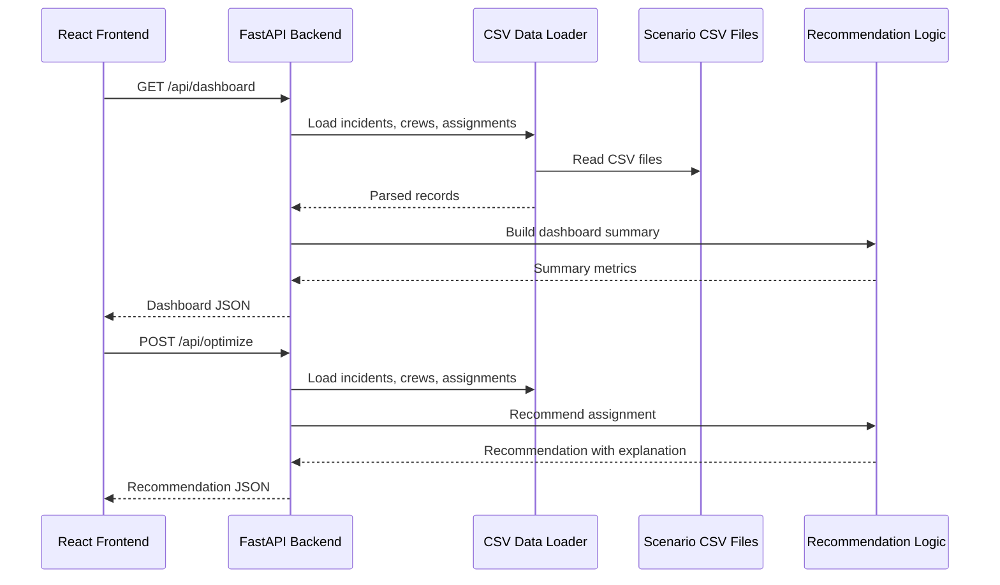
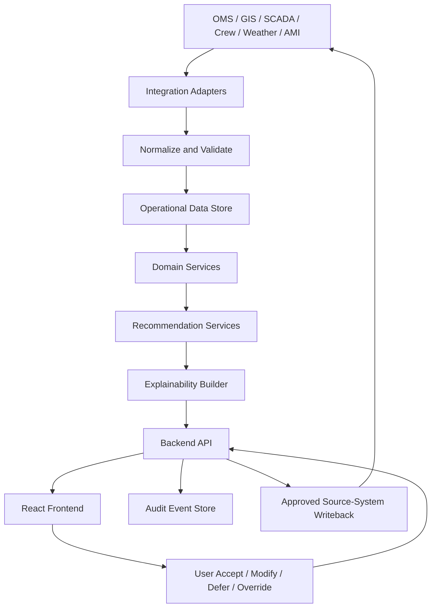

# Data Flow Architecture

## Purpose

This document describes how data moves through the AI Dispatch Advisor in the current Developer Bootstrap MVP and in the target enterprise architecture.

## Current MVP Data Flow

The current MVP uses synthetic CSV scenario files as source data.

## Current Source Files

| File | Purpose |
| --- | --- |
| `PendingIncidents.csv` | Active outage and incident events |
| `Crews.csv` | Crew availability, capability, location, and readiness |
| `Assignments.csv` | Active crew assignments |
| `HistoricalRepairs.csv` | Reference repair duration and work type context |
| `Weather.csv` | Regional weather and hazard conditions |
| `CriticalFacilities.csv` | Critical facility records and priority levels |
| `Topology.csv` | Simplified feeder and asset connectivity |

## Current API Data Flows

### Dashboard Flow

1. Frontend calls `GET /api/dashboard`.
2. Backend loads incidents, crews, and assignments.
3. Backend calculates summary metrics.
4. Frontend renders metric cards and priority incident queue.

### Incident Queue Flow

1. Frontend calls `GET /api/incidents`.
2. Backend loads incidents.
3. Backend ranks incidents using deterministic scoring.
4. Frontend renders the queue and selected incident state.

### Recommendation Flow

1. Frontend calls `POST /api/optimize`.
2. Backend selects the requested incident or top ranked incident.
3. Backend loads crews and assignments.
4. Backend calculates a crew recommendation.
5. Backend returns recommendation action, crew, confidence, expected impact, factors, constraints, and alternatives.
6. Frontend displays the recommendation panel.

### Copilot Flow

1. Frontend sends a message to `POST /api/chat`.
2. Backend evaluates message keywords.
3. Backend reads summary or selected incident context.
4. Backend returns an advisory response.
5. Frontend displays the response in the Copilot conversation panel.

The current Copilot flow is not LLM-backed.

### Database Initialization Flow

1. Developer runs `python3 scripts/init_db.py`.
2. Script applies `database/schema.sql`.
3. Script loads selected CSV files into `database/aida.db`.
4. The generated database is ignored by Git.

The backend does not yet read from SQLite.

## Target Enterprise Data Flow

## Target Data Categories

### Operational Source Data

Operational source data includes:

- Outage events.
- Trouble calls.
- Customers affected.
- Crew availability.
- Crew assignments.
- Asset and feeder context.
- Device telemetry and alarms.
- Weather and hazard context.

### Recommendation Data

Recommendation data includes:

- Recommendation identifier.
- Related incident.
- Recommended action.
- Recommended crew or resource.
- Confidence.
- Factors.
- Constraints.
- Alternatives.
- Model or algorithm version.
- Source data snapshot reference.

### User Decision Data

User decision data includes:

- User identity.
- Action type.
- Accepted, modified, deferred, or overridden recommendation.
- Override category and note.
- Timestamp.
- Related incident and crew.
- Prior recommendation state.

### Audit Data

Audit data includes:

- Recommendation generation events.
- User action events.
- Integration read and write events.
- Authentication and authorization events.
- Error and exception events.
- Data quality warnings.

## Data Quality Controls

The architecture should track:

- Required fields.
- Missing values.
- Stale records.
- Conflicting source values.
- Source timestamp.
- Processing timestamp.
- Integration health.
- Confidence impact.

Recommendations should surface quality concerns that materially affect dispatch decisions.

## Data Ownership

| Data Domain | System of Record | AI Dispatch Advisor Role |
| --- | --- | --- |
| Outage events | OMS | Read, normalize, recommend, optionally write approved actions |
| Asset and topology | GIS | Read and contextualize |
| Device telemetry | SCADA or DMS | Read and constrain recommendations |
| Crew status | Crew management system | Read and recommend assignments |
| Weather | Weather provider | Read and contextualize |
| Recommendations | AI Dispatch Advisor | Generate and persist |
| User decisions | AI Dispatch Advisor and possibly OMS | Capture, audit, and optionally write approved action |

## Privacy and Sensitive Data

The data architecture should minimize sensitive data. Sample data must remain fictional. Production data handling should identify and protect:

- Employee or crew personally identifiable information.
- Customer information.
- Critical infrastructure details.
- Operational security information.
- Integration credentials.

## Related Documents

- [System Context](201_System_Context.md)
- [Solution Architecture](202_Solution_Architecture.md)
- [Component Architecture](203_Component_Architecture.md)
- [Integration Architecture](204_Integration_Architecture.md)
- [Deployment Architecture](206_Deployment_Architecture.md)

