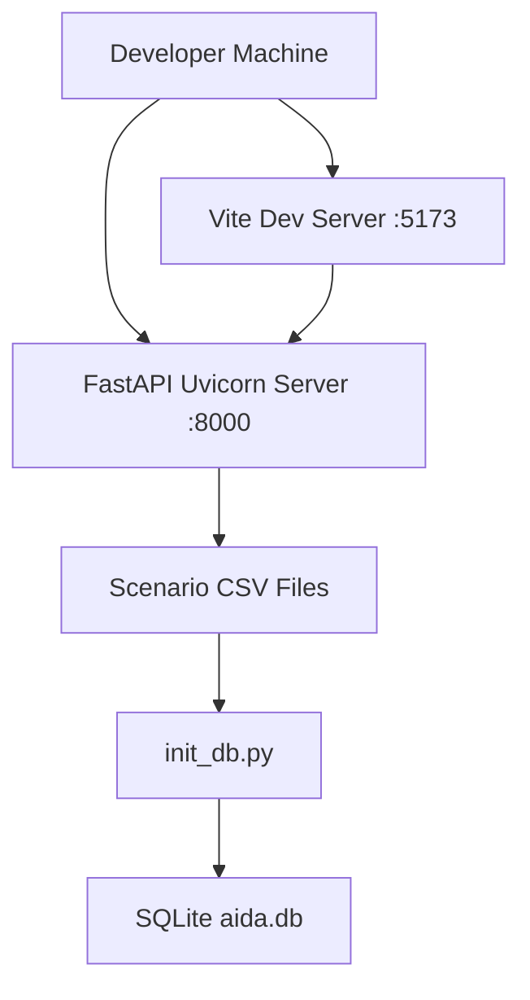
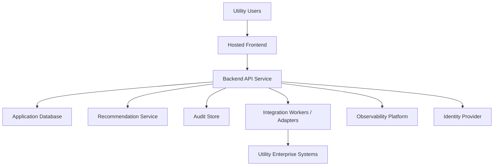

# Deployment Architecture

## Purpose

This document describes the deployment architecture for the AI Dispatch Advisor. It covers the current local Developer Bootstrap MVP, CI baseline, Docker support, and target enterprise deployment considerations.

## Current Local Deployment

The current MVP is designed for local development and POC demonstration.

### Frontend

Location:

- `frontend/`

Run command:

```bash
npm install
npm run dev
```

Default URL:

```text
http://127.0.0.1:5173/
```

### Backend

Location:

- `backend/`

Run command:

```bash
python3 -m venv .venv
source .venv/bin/activate
pip install -r requirements.txt
uvicorn app.main:app --reload
```

Default URL:

```text
http://127.0.0.1:8000/
```

### API Documentation

FastAPI exposes local OpenAPI documentation at:

```text
http://127.0.0.1:8000/docs
```

### Local Database

Create a local SQLite demo database with:

```bash
python3 scripts/init_db.py
```

This creates:

```text
database/aida.db
```

The generated database is ignored by Git.

## Current Container Deployment

The repository includes Docker Compose support:

```bash
docker compose up
```

Current services:

| Service | Purpose | Port |
| --- | --- | --- |
| `frontend` | React development server | `5173` |
| `backend` | FastAPI application | `8000` |

The current Compose configuration is for local development, not production hosting.

## Current CI Deployment Support

GitHub Actions is configured under:

```text
.github/workflows/ci.yml
```

Current CI checks:

- Backend dependency install.
- Backend tests.
- Frontend dependency install.
- Frontend build.

## Current Deployment Diagram



## Target Enterprise Deployment

The target enterprise deployment should support separate deployment of frontend, backend, data stores, integration workers, and recommendation services.



## Target Deployment Components

| Component | Deployment Consideration |
| --- | --- |
| Frontend | Static web hosting, CDN, internal portal, or utility-approved app hosting |
| Backend API | Containerized service, app platform, Kubernetes, or enterprise Python runtime |
| Recommendation Service | Same backend initially; separable service if computation or scaling requires it |
| Database | Managed relational database for operational state, audit events, and recommendation history |
| Scenario and reference data | Controlled deployment artifact or enterprise-managed object store, database, configuration service, or integration pipeline; not a developer-writable bind mount |
| Integration Workers | Separately scalable workers for source-system polling, subscriptions, or message handling |
| Observability | Logs, metrics, traces, alerts, dashboards, and correlation identifiers |
| Identity | Enterprise SSO, role claims, and access policies |
| Secrets | Managed secret store, not source control or local config files |

## Environment Model

Recommended environments:

| Environment | Purpose |
| --- | --- |
| Local | Individual development and demo review |
| Development | Shared engineering integration |
| Test or QA | Validation, regression testing, stakeholder review |
| Staging | Production-like deployment and release validation |
| Production | Approved operational use |

## Configuration Management

Configuration should include:

- API base URLs.
- Integration endpoints.
- Environment name.
- Feature flags.
- Scenario selection for demo or non-production environments.
- Logging level.
- Identity provider configuration.
- Secrets references.

Configuration should not include raw credentials committed to source control.

## Production Readiness Gaps

The current MVP is not production-ready. Gaps include:

- No production authentication.
- No role-based authorization enforcement.
- No production database integration.
- No integration adapters.
- No production-grade secrets management.
- No centralized observability.
- No high availability design.
- No release promotion workflow.
- No backup or disaster recovery plan.
- Scenario files are supplied through a local developer directory rather than a controlled, versioned production data source.

## Deployment Principles

The deployment architecture should follow these principles:

- Keep frontend and backend independently deployable.
- Use environment-specific configuration.
- Keep secrets out of source control.
- Make health checks explicit.
- Prefer immutable builds for production.
- Treat integration workers as independently observable components.
- Preserve audit data across deployments.

## Related Documents

- [System Context](201_System_Context.md)
- [Solution Architecture](202_Solution_Architecture.md)
- [Component Architecture](203_Component_Architecture.md)
- [Integration Architecture](204_Integration_Architecture.md)
- [Data Flow Architecture](205_Data_Flow_Architecture.md)
