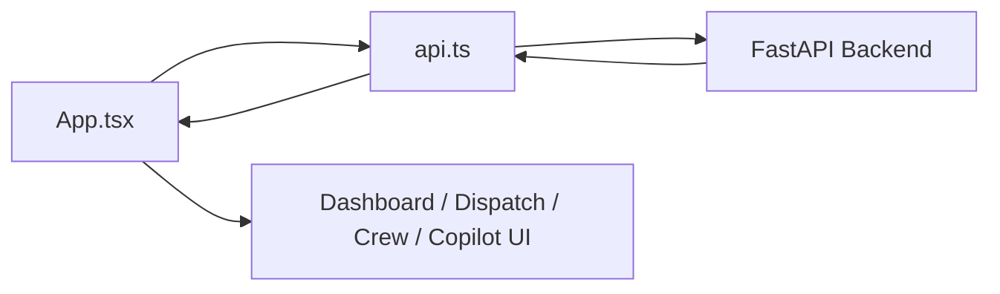
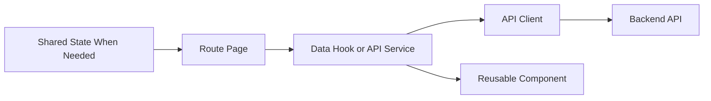

# Frontend Architecture

## Purpose

This document defines the frontend architecture for the AI Dispatch Advisor. It describes the current React/Vite proof-of-concept, target application structure, frontend responsibilities, integration with backend APIs, and the evolution path from a single-file demo shell to a maintainable enterprise frontend.

## Current Implementation State

The Developer Bootstrap MVP includes a React and TypeScript frontend under:

```text
frontend/
  index.html
  package.json
  tsconfig.json
  vite.config.ts
  src/
    App.tsx
    api.ts
    main.tsx
    styles.css
    types.ts
    vite-env.d.ts
```

The current frontend:

- Uses React, TypeScript, and Vite.
- Renders a dispatch operations shell.
- Provides local navigation between dashboard, dispatch, incidents, crew board, storm mode, scenario, and AI Copilot sections.
- Calls the FastAPI backend through `frontend/src/api.ts`.
- Uses synthetic backend data.
- Uses local React state.
- Does not yet use React Router, a component library, a data grid library, map library, or global state library.

## Frontend Architecture Goals

The frontend should:

- Support a clear enterprise operations-console experience.
- Keep dispatcher workflows fast and scannable.
- Separate page, component, state, and API concerns.
- Treat backend APIs as the source of operational data.
- Make recommendations explainable and visibly advisory.
- Support future role-aware navigation.
- Remain maintainable as POC features become real workflows.
- Preserve accessibility and responsive layout expectations.

## Current Frontend Component Model

Current implementation is intentionally compact:

| File | Responsibility |
| --- | --- |
| `src/main.tsx` | Mounts React app |
| `src/App.tsx` | Main app shell, navigation, pages, panels, local state |
| `src/api.ts` | Backend API client |
| `src/types.ts` | Shared frontend TypeScript types |
| `src/styles.css` | Application styling |

This structure is acceptable for the bootstrap MVP, but it should be refactored before major UI expansion.

## Target Frontend Structure

Recommended target structure:

```text
frontend/src/
  app/
    App.tsx
    routes.tsx
    layout/
      AppShell.tsx
      Sidebar.tsx
      Topbar.tsx
  api/
    client.ts
    dashboardApi.ts
    incidentsApi.ts
    crewsApi.ts
    recommendationsApi.ts
  components/
    actions/
    feedback/
    layout/
    metrics/
    recommendations/
    tables/
  pages/
    DashboardPage.tsx
    DispatchPage.tsx
    IncidentsPage.tsx
    CrewBoardPage.tsx
    StormModePage.tsx
    ScenarioPage.tsx
    CopilotPage.tsx
  state/
    dispatchState.ts
    recommendationState.ts
  styles/
    tokens.css
    global.css
  types/
    api.ts
    domain.ts
```

This is a target direction, not an immediate refactor requirement.

## Architectural Layers

### App Shell

Responsibilities:

- Provide stable layout.
- Render primary navigation.
- Show current environment or scenario.
- Own application-level providers when added.

Current POC:

- App shell is embedded in `App.tsx`.

Target:

- Extract `AppShell`, `Sidebar`, and `Topbar`.

### Pages

Responsibilities:

- Represent route-level user workflows.
- Compose reusable components.
- Request data through API hooks or service functions.
- Own page-specific state.

Target pages:

- Dashboard.
- Dispatch.
- Incidents.
- Crew Board.
- Storm Mode.
- Scenario.
- AI Copilot.

### Components

Responsibilities:

- Render reusable UI patterns.
- Avoid direct backend calls unless intentionally designed as a data component.
- Accept typed props.
- Keep workflow behavior in pages or state services.

Candidate components:

- `MetricCard`.
- `IncidentTable`.
- `CrewCard`.
- `RecommendationPanel`.
- `RecommendationActions`.
- `CopilotPanel`.
- `StatusPill`.
- `ErrorBanner`.

### API Client

Responsibilities:

- Encapsulate backend calls.
- Provide typed request and response shapes.
- Centralize base URL and error handling.

Current POC:

- `src/api.ts`.

Target:

- Split by API domain.
- Add consistent error normalization.
- Consider generated types once backend OpenAPI contracts stabilize.

### State

Responsibilities:

- Track selected incident.
- Track loaded operational data.
- Track recommendation action state.
- Track UI feedback and errors.

Current POC:

- Local state in `App.tsx`.

Target:

- Keep local state for page-only concerns.
- Add shared state only when multiple pages need coordinated state.
- Avoid premature global state.

## Data Flow

Current frontend data flow:



Target data flow:



## Styling Architecture

Current POC:

- Single `styles.css`.
- Custom CSS.
- No component library.

Target direction:

- Preserve custom CSS or adopt a design system intentionally.
- Define design tokens for color, spacing, typography, and status.
- Keep enterprise operations styling restrained and scannable.
- Avoid marketing-style hero layouts.
- Keep cards for repeated items and panels, not nested decorative surfaces.

## Current Gaps

Known frontend gaps:

- Single large `App.tsx`.
- No route URLs.
- No persistent recommendation action workflow.
- No map component.
- No data grid library.
- No formal design tokens.
- No automated frontend tests.
- No role-based navigation.
- No production authentication handling.

## Refactor Triggers

Refactor the frontend structure when:

- Recommendation actions become demo-functional.
- Multiple pages need shared selected incident or scenario state.
- More than one table needs filtering or sorting.
- Routing URLs become important.
- Backend API contracts stabilize.
- User roles affect visible pages or controls.
- A map or advanced grid is introduced.

## Related Documents

- [State Management](502_State_Management.md)
- [Component Guidelines](503_Component_Guidelines.md)
- [Routing and Navigation](504_Routing_and_Navigation.md)
- [UI Information Architecture](../300_UX/301_UI_Information_Architecture.md)

