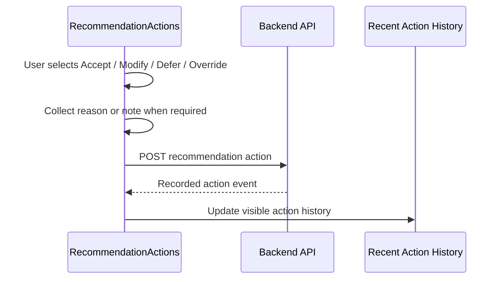

# State Management

## Purpose

This document defines state management guidance for the AI Dispatch Advisor frontend. It describes current POC state, target state boundaries, when to keep state local, when to introduce shared state, and how frontend state should relate to backend operational state.

## Current Implementation State

The current POC keeps state inside `frontend/src/App.tsx` using React `useState`, `useEffect`, and `useMemo`.

Current state includes:

- Current selected view.
- Dashboard summary.
- Incident list.
- Crew list.
- Assignment list.
- Current recommendation.
- Recommendation action loading, feedback, and recent history.
- Selected incident identifier.
- Available scenarios, active scenario, and activation feedback.
- Copilot prompt.
- Copilot conversation state.
- Loading and error feedback.

This is appropriate for the bootstrap MVP because the application is still compact and all views are in one component.

## State Management Principles

Frontend state should follow these principles:

- Keep state local until sharing is needed.
- Treat backend APIs as the source of operational truth.
- Avoid duplicating backend-derived data in multiple state shapes.
- Keep selected UI context separate from persisted operational state.
- Do not rely on frontend-only state for audit or dispatch decisions.
- Make optimistic UI behavior explicit when used.
- Preserve clear distinction between recommendation and approved action.

## State Categories

### Server State

Server state is data fetched from backend APIs.

Examples:

- Incidents.
- Crews.
- Assignments.
- Dashboard summary.
- Recommendation responses.
- Recommendation action history.
- Integration health.

Recommended handling:

- Fetch through API services.
- Cache only when useful.
- Refresh after mutating actions.
- Show loading and error states.

Future option:

- Introduce React Query or equivalent once data fetching becomes more complex.

### UI State

UI state is local interaction state.

Examples:

- Selected page.
- Selected incident.
- Expanded panels.
- Open modal.
- Form text.
- Active filter.
- Sort order.

Recommended handling:

- Keep in page or component state.
- Promote to shared state only when multiple pages need it.

### Workflow State

Workflow state represents in-progress user actions.

Examples:

- Accepting a recommendation.
- Entering modification note.
- Entering override reason.
- Deferring a recommendation.
- Waiting for action confirmation.

Recommended handling:

- Keep form state local to action components.
- Persist final action to backend.
- Show confirmation from backend response.
- Refresh recent action history.

### Application Context State

Application context state applies broadly.

Examples:

- Active demo scenario.
- Current user.
- Current role.
- Environment.
- Feature flags.

Recommended handling:

- Use a small provider or shared state module when needed.
- Keep role and permission enforcement on backend.

## Current State Map

| State | Current Location | Target Direction |
| --- | --- | --- |
| Selected view | `App.tsx` | Move to router once routing is introduced |
| Selected incident | `App.tsx` | Shared page state or route parameter |
| Dashboard data | `App.tsx` | Server-state hook or API query |
| Incident data | `App.tsx` | Server-state hook with filters |
| Crew data | `App.tsx` | Server-state hook with filters |
| Recommendation | `App.tsx` | Recommendation query keyed by incident |
| Recommendation actions | `App.tsx` and backend SQLite | Server state keyed by scenario and incident |
| Active scenario | `App.tsx` and process-local backend state | Session- or environment-scoped application context |
| Copilot turns | `App.tsx` | Copilot page state |
| Errors | `App.tsx` | Shared error banner pattern |

## Recommendation Action State

The implemented Accept, Modify, Defer, and Override workflow includes:

- Selected recommendation.
- Pending action type.
- Action note or reason.
- Action request loading state.
- Action response.
- Recent action history.

Current POC flow:

## When to Introduce Global State

Global state may be justified when:

- Selected incident must drive multiple independent pages.
- Scenario selection affects all API calls.
- User role controls many visible UI elements.
- Recommendation action history appears across pages.
- Integration health must be visible in the shell.

Avoid global state for:

- Single form fields.
- One-page table filters.
- Temporary modal state.
- Data that can be fetched directly from backend.

## Candidate State Tools

The documentation roadmap mentioned possible use of Zustand and React Query. These should be introduced only when the need is clear.

Recommended direction:

- Use React local state for simple UI state.
- Use React Query or equivalent for server-state caching and refresh.
- Use Zustand or React Context for small shared app context if needed.

Do not introduce Redux or a large state framework unless the application complexity clearly requires it.

## Error State Guidelines

The frontend should display:

- Backend unavailable.
- API request failed.
- Recommendation unavailable.
- Action save failed.
- Required reason missing.
- No data available.

Errors should be operationally meaningful. Avoid exposing raw stack traces to users.

## Loading State Guidelines

Loading states should be visible for:

- Initial app data load.
- Recommendation refresh.
- Copilot response.
- Recommendation action save.

The UI should avoid silent waits after user action.

## Persistence Boundary

Frontend state is not durable. Any operationally meaningful action must be recorded through the backend.

Examples:

- Accepted recommendation.
- Modified recommendation.
- Deferred recommendation.
- Override reason.
- Assignment decision.
- Audit event.

## Related Documents

- [Frontend Architecture](501_Frontend_Architecture.md)
- [Component Guidelines](503_Component_Guidelines.md)
- [Routing and Navigation](504_Routing_and_Navigation.md)
- [Recommendation Experience](../300_UX/303_Recommendation_Experience.md)
