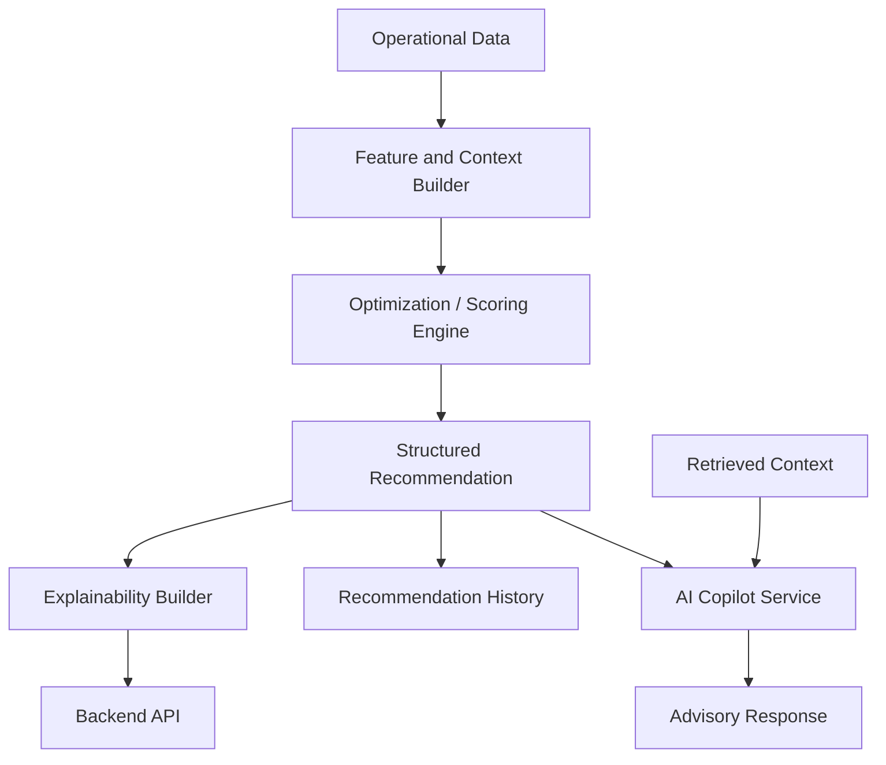

# AI Recommendation Engine

## Purpose

This document defines the AI recommendation engine direction for the AI Dispatch Advisor. It clarifies the difference between deterministic optimization, AI-assisted advisory behavior, explainability, and future model-backed capabilities.

## Current Implementation State

The current POC includes:

- Deterministic recommendation logic in `backend/app/recommendations.py`.
- Keyword-based Copilot demo responses in `backend/app/main.py`.
- Synthetic CSV input data.
- Recommendation responses with factors, constraints, confidence, expected impact, and alternatives.
- Internal structured incident-priority contributions under algorithm `deterministic-scoring-v2` and policy `incident-priority-v1`.

The current POC does not include:

- A real machine learning model.
- An LLM-backed Copilot.
- Retrieval-augmented generation.
- Model serving infrastructure.
- Model evaluation framework.

## Recommendation Engine Goals

The recommendation engine should:

- Provide dispatch recommendations grounded in operational data.
- Combine deterministic optimization with AI-assisted explanation where appropriate.
- Keep human approval central.
- Produce structured outputs for UI, audit, and review.
- Preserve a clear safety boundary between advisory output and operational action.

## Recommendation Types

Target recommendation types include:

| Type | Description |
| --- | --- |
| Incident Priority | Which incidents should be reviewed first |
| Crew Assignment | Which crew is best suited for an incident |
| Scenario Recommendation | Which dispatch scenario best fits current objectives |
| Storm Mode Priority | Which regions, facilities, or hazards need immediate attention |
| Data Quality Warning | Where stale or missing data affects decision confidence |
| Copilot Advisory Response | Natural language explanation or summary |

## Engine Architecture Direction

## Deterministic Versus AI-Assisted Responsibilities

### Deterministic Logic

Best suited for:

- Rule-based eligibility.
- Crew availability.
- Capability matching.
- Constraint handling.
- Priority scoring.
- Optimization problem solving.
- Audit-friendly calculations.

### AI-Assisted Logic

Best suited for:

- Natural language explanation.
- Summarization of visible operational context.
- Drafting operator-readable rationale.
- Querying documentation or historical patterns.
- Helping users understand recommendation factors.

AI-assisted logic should not independently approve or execute dispatch decisions.

## Current Recommendation Response Baseline

Current recommendation response includes:

- `incident_id`.
- `recommended_action`.
- `recommended_crew`.
- `confidence`.
- `expected_impact`.
- `factors`.
- `constraints`.
- `alternatives`.

This is a good POC baseline. Future work should add:

- `recommendation_id`.
- `generated_at`.
- `source_data_snapshot_id`.
- `algorithm_version`.
- `model_version`.
- `expires_at`.
- `data_quality_warnings`.

## Copilot Direction

The Copilot should remain advisory and bounded.

Allowed:

- Explain a recommendation.
- Summarize active incidents.
- Summarize critical facility impact.
- Explain crew availability.
- Identify what data influenced a recommendation.

Not allowed:

- Dispatch a crew.
- Accept a recommendation.
- Override a recommendation.
- Write to OMS or crew systems.
- Hide uncertainty or missing data.

## Retrieval and Context Direction

Future AI responses should be grounded in:

- Selected incident.
- Current recommendation.
- Crew options.
- Critical facility records.
- Weather context.
- Data freshness metadata.
- Relevant documentation.
- Prior audit events when permitted.

The system should avoid unsupported free-form operational claims.

## Recommendation Confidence

Confidence should reflect:

- Data completeness.
- Data freshness.
- Crew suitability.
- Objective tradeoffs.
- Constraint severity.
- Alternative quality.
- Integration health.

Confidence should not be presented as a guarantee.

## Audit and Traceability

Each recommendation should eventually record:

- Inputs used.
- Data snapshot reference.
- Algorithm version.
- Model version if AI output is used.
- Recommendation output.
- Explanation.
- User action.
- Outcome, when available.

## Evaluation Strategy

Recommendation quality should be evaluated using:

- Synthetic scenario tests.
- Historical replay when available.
- Dispatcher review.
- Override rate.
- Acceptance rate.
- Restoration outcome comparison.
- Data quality sensitivity.
- Safety and policy compliance checks.

## Current Gaps

Known gaps:

- No model-backed recommendation service.
- No retrieval layer.
- No recommendation persistence.
- No evaluation harness.
- No prompt or model version tracking.
- No outcome feedback loop.

## Related Documents

- [Data Model](601_Data_Model.md)
- [Optimization Engine](602_Optimization_Engine.md)
- [Explainability Model](604_Explainability_Model.md)
- [Model Governance](605_Model_Governance.md)
