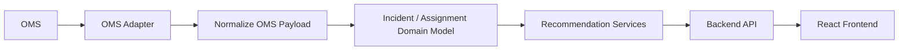

# OMS Integration

## Purpose

This document defines the target Outage Management System integration for the AI Dispatch Advisor. It describes the role of the OMS, current POC simulation, expected data domains, integration patterns, writeback governance, data quality concerns, and production readiness considerations.

## Current Implementation State

The current Developer Bootstrap MVP does not connect to a live OMS. OMS-like outage data is simulated by:

```text
data/scenarios/base/PendingIncidents.csv
data/scenarios/base/Assignments.csv
```

The backend exposes this data through:

```text
GET /api/incidents
GET /api/incidents/{incident_id}
GET /api/assignments
GET /api/dashboard
```

The current POC is read-only with respect to source systems. It does not write approved dispatch actions back to an OMS.

## OMS Role

In a utility environment, the OMS is expected to be the system of record for:

- Outage events.
- Trouble calls.
- Outage prediction.
- Customer impact.
- Restoration status.
- ETR information.
- Crew assignment status, depending on utility configuration.
- Outage history and restoration records.

The AI Dispatch Advisor should not replace the OMS. It should act as a decision-support layer that reads OMS data, recommends dispatch actions, and optionally writes approved actions back only when explicitly governed.

## Target Integration Objectives

The OMS integration should:

- Retrieve active outages and trouble events.
- Retrieve outage status, customer impact, and ETR context.
- Retrieve current assignment state when OMS owns assignment records.
- Provide source metadata and data freshness.
- Support incident prioritization and recommendation generation.
- Optionally support approved action writeback.
- Preserve auditability of all recommendation and writeback activity.

## Target Data Inbound From OMS

| Data | Purpose |
| --- | --- |
| Outage event identifier | Links recommendations to OMS records |
| Outage status | Determines whether incident needs dispatch action |
| Affected customer count | Supports prioritization |
| Trouble call details | Provides field and customer-reported context |
| Predicted device or asset | Links OMS events to topology and GIS |
| ETR | Supports dispatcher review and customer impact context |
| Crew assignment state | Prevents conflicting recommendations |
| Priority or critical customer flag | Supports prioritization policy |
| Timestamps | Supports data freshness and auditability |

## Target Data Outbound To OMS

Potential writeback data:

- Approved crew assignment.
- Dispatch recommendation note.
- Deferral note.
- Override reason.
- Assignment status update.

Writeback should be deferred until the utility confirms:

- OMS write contracts.
- Authorized action types.
- User role permissions.
- Audit requirements.
- Error handling and reconciliation process.

## Integration Pattern

The recommended pattern is an OMS adapter:



The adapter should isolate vendor-specific OMS details from domain services and frontend code.

## Adapter Responsibilities

The OMS adapter should:

- Authenticate to the OMS.
- Retrieve active outage data.
- Retrieve outage detail by identifier.
- Normalize OMS payloads.
- Attach source metadata.
- Track data freshness.
- Handle pagination or incremental sync.
- Handle source errors and degraded states.
- Support writeback only through governed service methods.

The OMS adapter should not:

- Contain UI logic.
- Contain recommendation scoring logic.
- Expose raw OMS payloads to normal frontend views.
- Write operational actions without backend authorization and audit logging.

## Data Freshness

OMS records should include:

- `source_system`.
- `source_record_id`.
- `source_updated_at`.
- `loaded_at`.
- `freshness_status`.
- `quality_warnings`.

Stale OMS data should reduce recommendation confidence and be visible in the UI when material.

## Identity and Authorization

OMS writeback should require:

- Authenticated user.
- Authorized dispatcher or supervisor role.
- Valid recommendation action.
- Audit event.
- OMS acknowledgement.

The backend must enforce permissions. The frontend should not be the enforcement boundary.

## Error Handling

Expected OMS integration errors:

| Error | Expected Behavior |
| --- | --- |
| OMS unavailable | Show degraded state and use last known data only if policy allows |
| Outage record missing | Return clear not-found or stale-record message |
| Writeback rejected | Preserve local audit event and show action failure |
| Assignment conflict | Require user review and refresh source state |
| Data stale | Lower confidence and label data freshness issue |

## Audit Requirements

Audit events should be recorded for:

- OMS data loaded.
- Recommendation generated from OMS data.
- User action on recommendation.
- OMS writeback attempted.
- OMS writeback succeeded.
- OMS writeback failed.

## POC-to-Enterprise Transition

| POC | Enterprise Direction |
| --- | --- |
| `PendingIncidents.csv` | OMS outage feed or API |
| `Assignments.csv` | OMS or workforce assignment source |
| Static data load | Incremental updates or event-driven sync |
| No writeback | Governed approved-action writeback |
| No source metadata | Full provenance and freshness tracking |

## Open Questions

- Which OMS vendor or implementation is targeted first?
- Does OMS own crew assignment state for the utility?
- Are writeback operations permitted in phase one?
- What outage event lifecycle states must be supported?
- What latency is acceptable for dispatch decision support?

## Related Documents

- [Integration Architecture](../200_Architecture/204_Integration_Architecture.md)
- [Outage API](../400_Backend_API/403_Outage_API.md)
- [Recommendation API](../400_Backend_API/405_Recommendation_API.md)

