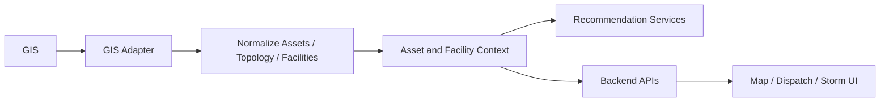

# GIS Integration

## Purpose

This document defines the target Geographic Information System integration for the AI Dispatch Advisor. It describes how GIS data should support asset context, feeder relationships, topology, critical facilities, mapping, and recommendation explainability.

## Current Implementation State

The current POC does not connect to a live GIS. GIS-like context is simulated by:

```text
data/scenarios/base/Topology.csv
data/scenarios/base/CriticalFacilities.csv
```

The backend exposes this data through:

```text
GET /api/topology
GET /api/critical-facilities
```

The current frontend does not yet include an interactive map.

## GIS Role

In a utility environment, GIS is expected to be the system of record for:

- Asset location.
- Feeder and circuit relationships.
- Switches, transformers, protective devices, and service points.
- Network connectivity.
- Landbase and operating boundaries.
- Critical facility location and feeder association.

The AI Dispatch Advisor should use GIS to contextualize outages and improve recommendation quality. It should not replace GIS as the asset or topology system of record.

## Target Integration Objectives

The GIS integration should:

- Link outage incidents to feeders, circuits, assets, and geography.
- Provide critical facility context.
- Support map-based situational awareness.
- Support topology-informed recommendation logic.
- Provide source metadata and data freshness.
- Support scenario analysis and storm mode visualization.

## Target Data Inbound From GIS

| Data | Purpose |
| --- | --- |
| Asset identifiers | Link outages to equipment and topology |
| Asset type | Understand repair context and work requirements |
| Asset location | Support maps, travel estimates, and field response |
| Feeder or circuit | Support outage grouping and restoration strategy |
| Connectivity | Support topology-aware reasoning |
| Critical facilities | Support priority and customer impact context |
| Operating boundaries | Support regional views and dispatch filters |
| Switch and device state metadata | Support restoration sequencing when available |

## Integration Pattern

Recommended pattern:



The GIS adapter should isolate vendor-specific GIS schemas and geospatial services from application domain models.

## Adapter Responsibilities

The GIS adapter should:

- Authenticate to GIS services.
- Retrieve asset and topology records.
- Retrieve critical facility records.
- Normalize geometry and asset attributes.
- Attach source metadata and freshness.
- Support lookup by feeder, asset, incident, region, or facility.
- Handle stale topology and partial data.

The GIS adapter should not:

- Contain recommendation scoring rules.
- Expose raw geospatial payloads directly to standard UI components.
- Perform grid control actions.

## Topology Data

Topology data should support:

- Feeder relationships.
- Parent and child asset relationships.
- Protective device context.
- Transformer and service area context.
- Critical facility connectivity.

The current `Topology.csv` is a simplified placeholder. Production topology modeling requires utility-specific GIS and network model review.

## Critical Facility Data

Critical facility records should include:

- Facility identifier.
- Facility name.
- Facility type.
- Region.
- Municipality.
- Feeder.
- Priority level.
- Source system.
- Last updated timestamp.

Critical facility impact should be visible in both incident queues and recommendation explanations.

## Map Direction

Future frontend map support should show:

- Incident location.
- Crew location.
- Critical facilities.
- Feeders or outage areas.
- Weather or access hazards.

Maps should support dispatch context but should not hide critical workflow information that must also be available in tables and panels.

## Data Freshness

GIS data may change less frequently than OMS or crew data, but stale topology can still affect recommendations.

Freshness metadata should include:

- GIS source update timestamp.
- Load timestamp.
- Cache age.
- Data quality warnings.
- Known topology limitations.

## Error Handling

Expected GIS integration errors:

| Error | Expected Behavior |
| --- | --- |
| GIS unavailable | Show degraded map or context state |
| Asset missing | Continue with outage data and mark asset context unavailable |
| Critical facility linkage missing | Lower confidence when relevant |
| Topology stale | Show warning and avoid topology-dependent claims |
| Geometry invalid | Exclude from map and log data quality issue |

## Security Considerations

GIS data may include sensitive infrastructure information. Access should be controlled by:

- Role.
- Environment.
- Data sensitivity.
- Utility policy.

Frontend map displays should avoid exposing unnecessary critical infrastructure detail.

## POC-to-Enterprise Transition

| POC | Enterprise Direction |
| --- | --- |
| `Topology.csv` | GIS topology or network model adapter |
| `CriticalFacilities.csv` | GIS or enterprise facility source |
| No map | Controlled map and geospatial context |
| Static feeder fields | Validated feeder and asset relationships |
| No geometry validation | Geospatial validation and source metadata |

## Open Questions

- Which GIS platform and data model will be targeted first?
- Does GIS or another system own critical facility records?
- What topology depth is required for initial recommendations?
- What infrastructure details may be shown in the UI?
- What map library and geospatial service should be used?

## Related Documents

- [Integration Architecture](../200_Architecture/204_Integration_Architecture.md)
- [Data Flow Architecture](../200_Architecture/205_Data_Flow_Architecture.md)
- [Data Model](../600_Data_AI/601_Data_Model.md)

