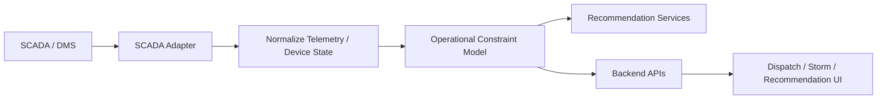

# SCADA Integration

## Purpose

This document defines the target SCADA or Distribution Management System integration for the AI Dispatch Advisor. It describes how telemetry, alarms, device state, and operational constraints should inform dispatch recommendations while preserving a clear boundary against direct grid control.

## Current Implementation State

The current POC does not connect to SCADA, DMS, or any live operational telemetry system. SCADA-like constraints are represented only indirectly through synthetic incident fields such as:

- Hazard.
- Feeder.
- Required skill.
- Severity.

There are no current SCADA endpoints.

## SCADA / DMS Role

SCADA and DMS platforms may provide:

- Device state.
- Alarms.
- Feeder status.
- Switch status.
- Fault indicators.
- Telemetry.
- Operational constraints.
- Switching or isolation context.

The AI Dispatch Advisor should use this data to improve situational awareness and recommendation constraints. It should not directly control grid devices in the initial implementation.

## Target Integration Objectives

The SCADA integration should:

- Provide operational state relevant to outage dispatch.
- Identify constraints affecting dispatch or restoration.
- Improve recommendation confidence.
- Surface stale or unavailable telemetry.
- Support explainability for topology or safety-related constraints.
- Avoid direct control or switching authority.

## Target Data Inbound From SCADA / DMS

| Data | Purpose |
| --- | --- |
| Device state | Understand energized/de-energized or open/closed state |
| Alarms | Identify hazards, faults, or abnormal conditions |
| Feeder status | Support outage context and restoration planning |
| Fault indicators | Improve incident localization and prioritization |
| Switching context | Identify dependencies or restrictions |
| Telemetry timestamp | Support freshness and confidence |
| Operational notes or tags | Identify clearance, hold, or safety constraints when available |

## Integration Pattern

## Adapter Responsibilities

The SCADA adapter should:

- Authenticate to approved telemetry or DMS interfaces.
- Retrieve or subscribe to relevant operational state.
- Normalize device, alarm, and feeder context.
- Attach source timestamps and freshness.
- Convert raw telemetry into dispatch-relevant constraints.
- Handle unavailable or restricted telemetry.
- Prevent direct control actions from AI Dispatch Advisor.

The adapter should not:

- Issue control commands.
- Perform switching.
- Expose sensitive telemetry broadly.
- Replace control room procedures.

## Control Boundary

The AI Dispatch Advisor must preserve a strict control boundary:

- Read operational state where permitted.
- Use state to inform recommendations.
- Display constraints and warnings.
- Require human review.
- Do not directly operate grid devices.
- Do not automate switching.

Any future control-related capability would require a separate architecture decision, safety review, cybersecurity review, and utility operational approval.

## Data Freshness

SCADA data is time-sensitive. Responses should include:

- Source timestamp.
- Loaded timestamp.
- Freshness status.
- Telemetry confidence.
- Quality warnings.

Stale telemetry should be clearly identified and should reduce confidence for recommendations that depend on device state.

## Recommendation Impact

SCADA context may affect:

- Incident priority.
- Crew safety constraints.
- Required crew type.
- Whether field patrol is required.
- Whether an incident is blocked by switching dependency.
- Whether restoration sequence assumptions are valid.

SCADA-derived constraints should be shown in recommendation explanations.

## Error Handling

Expected SCADA integration errors:

| Error | Expected Behavior |
| --- | --- |
| SCADA unavailable | Degraded state; avoid telemetry-dependent recommendation claims |
| Telemetry stale | Lower confidence and show warning |
| Device unknown | Continue with OMS/GIS context and mark missing device state |
| Access denied | Hide restricted data and log authorized diagnostic event |
| Conflicting state | Require user review and mark recommendation uncertainty |

## Security Considerations

SCADA integration requires strict security review. Controls should include:

- Read-only integration scope.
- Network segmentation review.
- Least-privilege credentials.
- No secrets in source control.
- Restricted telemetry visibility.
- Audit logging for access.
- No direct control path.

## POC-to-Enterprise Transition

| POC | Enterprise Direction |
| --- | --- |
| No SCADA integration | Read-only SCADA/DMS adapter |
| Hazard text fields | Structured operational constraints |
| Static feeder field | Feeder state and device context |
| No telemetry freshness | Timestamped telemetry and confidence |
| No control boundary implementation | Explicit read-only enforcement |

## Open Questions

- Which SCADA or DMS interface is available for decision support?
- Is read-only access permitted?
- What telemetry may be shown to dispatch users?
- What latency is acceptable?
- Which device states materially affect initial recommendation logic?

## Related Documents

- [Integration Architecture](../200_Architecture/204_Integration_Architecture.md)
- [Optimization Engine](../600_Data_AI/602_Optimization_Engine.md)
- [Explainability Model](../600_Data_AI/604_Explainability_Model.md)

