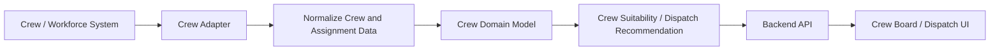

# Crew Management Integration

## Purpose

This document defines the target crew and workforce management integration for the AI Dispatch Advisor. It describes how crew availability, capability, location, assignments, shifts, and writeback behavior should support dispatch recommendations.

## Current Implementation State

The current POC does not connect to a live crew or workforce management system. Crew data is simulated by:

```text
data/scenarios/base/Crews.csv
data/scenarios/base/Assignments.csv
```

The backend exposes this data through:

```text
GET /api/crews
GET /api/assignments
POST /api/optimize
```

Recommendation logic currently uses synthetic crew availability, capability, storm readiness, and demo travel time.

## Crew System Role

A crew or workforce management system may be the system of record for:

- Crew roster.
- Crew status.
- Crew skills and certifications.
- Shift information.
- Assignments.
- Locations.
- Equipment.
- Contractor or mutual assistance resources.

The AI Dispatch Advisor should use this data to rank crew suitability and avoid conflicting assignments.

## Target Integration Objectives

The crew management integration should:

- Retrieve available, assigned, staged, and unavailable crews.
- Retrieve skills, certifications, equipment, and shift status.
- Retrieve current assignments.
- Retrieve current or last known location when permitted.
- Support crew suitability recommendations.
- Optionally write approved assignments back to the system of record.
- Track source freshness and assignment conflicts.

## Target Data Inbound

| Data | Purpose |
| --- | --- |
| Crew identifier | Links recommendations and assignments |
| Crew status | Determines availability |
| Crew capability | Determines suitability for work type |
| Certifications | Determines eligibility for specialized work |
| Equipment | Determines ability to complete work |
| Shift remaining | Avoids infeasible assignments |
| Current assignment | Prevents conflicts |
| Location | Supports travel and staging estimates |
| Last updated timestamp | Supports data freshness |

## Target Data Outbound

Potential writeback:

- Approved assignment.
- Assignment update.
- Assignment cancellation.
- Recommendation note.
- Override or deferral note.

Writeback should be introduced only after:

- Authorization is implemented.
- Audit event persistence exists.
- Source-system write contract is defined.
- Conflict reconciliation behavior is defined.

## Integration Pattern



## Adapter Responsibilities

The crew adapter should:

- Authenticate to the crew system.
- Retrieve crew roster and status.
- Retrieve active assignments.
- Retrieve skills, equipment, and shift constraints.
- Normalize crew records.
- Attach source metadata.
- Detect stale data.
- Support writeback only through governed service methods.

The crew adapter should not:

- Expose sensitive workforce details unnecessarily.
- Allow unaudited assignment writes.
- Contain UI rendering logic.
- Decide recommendations without recommendation service involvement.

## Crew Suitability Inputs

Crew suitability should consider:

- Availability.
- Work type capability.
- Certifications.
- Equipment.
- Travel time.
- Shift remaining.
- Current assignment.
- Storm readiness.
- Region or operating area.
- Safety restrictions.

## Data Freshness

Crew data can become stale quickly. Future crew responses should include:

- Last status update.
- Last location update.
- Source system.
- Freshness status.
- Assignment conflict indicator.

Stale crew status should reduce recommendation confidence and be visible to dispatchers.

## Security and Privacy

Crew data may include sensitive employee information. Controls should include:

- Role-based access.
- Minimal display of personal data.
- Protected location data.
- Audit logging for assignment actions.
- Secure credentials.
- No unnecessary crew personal identifiers in logs.

## Error Handling

Expected crew integration errors:

| Error | Expected Behavior |
| --- | --- |
| Crew system unavailable | Show degraded state and avoid stale assignment claims |
| Crew status stale | Lower confidence and display freshness warning |
| Assignment conflict | Require refresh and dispatcher review |
| Writeback failure | Show action failed and preserve audit event |
| Location unavailable | Recommend with reduced confidence or omit travel claim |

## POC-to-Enterprise Transition

| POC | Enterprise Direction |
| --- | --- |
| `Crews.csv` | Crew/workforce adapter |
| `Assignments.csv` | Assignment source or OMS/workforce integration |
| Static travel minutes | GIS/routing and live location estimate |
| Simple availability field | Status, shift, equipment, and assignment constraints |
| No writeback | Governed assignment writeback |

## Open Questions

- Which system owns crew status?
- Which system owns assignment writeback?
- Is live crew location available and permitted?
- What crew skills and certifications are required for initial recommendations?
- How are contractor and mutual assistance crews represented?

## Related Documents

- [Crew API](../400_Backend_API/404_Crew_API.md)
- [Recommendation API](../400_Backend_API/405_Recommendation_API.md)
- [Optimization Engine](../600_Data_AI/602_Optimization_Engine.md)

