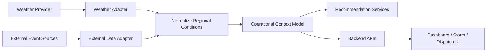

# Weather and External Data Integration

## Purpose

This document defines the target weather and external data integration for the AI Dispatch Advisor. It describes how weather, hazards, road access, external event data, and related context should support storm mode, dispatch prioritization, crew safety, and recommendation explainability.

## Current Implementation State

The current POC does not connect to live weather or external data providers. Weather data is simulated by:

```text
data/scenarios/base/Weather.csv
```

The backend exposes this data through:

```text
GET /api/weather
```

Synthetic incident records also include simple hazard text fields.

## External Data Role

Weather and external context may influence:

- Outage volume.
- Crew safety.
- Access constraints.
- Restoration duration.
- Storm mode operations.
- Critical facility risk.
- Travel estimates.
- Recommendation confidence.

The AI Dispatch Advisor should use weather and external data as supporting context, not as a sole basis for operational decisions.

## Target Integration Objectives

The weather and external data integration should:

- Retrieve current and forecast weather by region.
- Retrieve severe weather alerts.
- Track wind, precipitation, lightning, temperature, and storm risk.
- Support storm mode dashboards.
- Support recommendation constraints and explanations.
- Provide freshness and source metadata.
- Support demo scenarios and production feeds separately.

## Target Data Inbound

| Data | Purpose |
| --- | --- |
| Current condition | Dispatch and storm context |
| Forecast | Scenario planning |
| Wind speed and gusts | Safety and outage risk |
| Precipitation | Access and repair duration context |
| Lightning risk | Crew safety context |
| Temperature | Crew safety and restoration context |
| Weather alerts | Storm mode activation and prioritization |
| Road or access hazards | Crew routing and feasibility |
| External event feeds | Wildfire, flooding, emergency, or public safety context |

## Integration Pattern



## Adapter Responsibilities

Weather and external adapters should:

- Authenticate to providers where required.
- Retrieve current conditions and forecasts.
- Normalize provider-specific payloads.
- Attach source metadata and timestamps.
- Map data to operating regions.
- Handle provider outages and stale feeds.
- Avoid exposing raw provider payloads directly to the UI.

## Storm Mode Support

Weather data should support:

- Storm event summary.
- Regional conditions.
- Crew safety warnings.
- High-risk areas.
- Expected outage escalation.
- Mutual assistance planning context.

Storm mode should show weather as decision support, not as deterministic command output.

## Recommendation Impact

Weather and external data may affect:

- Incident priority.
- Crew suitability.
- Travel and access assumptions.
- Repair duration estimates.
- Confidence.
- Safety constraints.
- Scenario comparison.

Examples:

- High lightning risk may add a safety constraint.
- Heavy precipitation may increase access uncertainty.
- High winds may elevate hazard response priority.
- Flooding may make a nearby crew less feasible.

## Data Freshness

Weather data freshness should include:

- Provider timestamp.
- Loaded timestamp.
- Forecast issuance time.
- Region mapping confidence.
- Freshness status.

Stale weather data should be visible when it affects storm or dispatch recommendations.

## External Data Sources

Potential future sources:

- Weather providers.
- National Weather Service alerts.
- Road closure feeds.
- Emergency management feeds.
- Wildfire or flood feeds.
- Mutual assistance coordination sources.
- Public safety or municipal feeds.

Each external source should be evaluated for licensing, reliability, latency, and operational relevance.

## Error Handling

Expected errors:

| Error | Expected Behavior |
| --- | --- |
| Weather provider unavailable | Show degraded weather context and avoid weather-dependent claims |
| Forecast stale | Display stale warning and lower scenario confidence |
| Region mapping missing | Omit regional weather influence for affected area |
| External source conflicting | Require source labeling and avoid unsupported conclusion |
| Provider rate limit | Use cached data when permitted and show freshness |

## Security and Licensing

External data integrations should consider:

- API key management.
- Provider terms of use.
- Data redistribution rights.
- Attribution requirements.
- Rate limits.
- Reliability and service-level expectations.

API keys and provider secrets must not be committed to source control.

## POC-to-Enterprise Transition

| POC | Enterprise Direction |
| --- | --- |
| `Weather.csv` | Weather provider adapter |
| Static hazard text | Structured hazard and access context |
| One scenario | Multiple weather-driven demo scenarios |
| No forecast | Current plus forecast conditions |
| No provider metadata | Source timestamps, licensing, and freshness |

## Open Questions

- Which weather provider should be used first?
- What weather attributes most affect dispatch decisions?
- Should road access data be included in phase one?
- What attribution or licensing requirements apply?
- How should storm mode thresholds be configured?

## Related Documents

- [Integration Architecture](../200_Architecture/204_Integration_Architecture.md)
- [Data Model](../600_Data_AI/601_Data_Model.md)
- [Optimization Engine](../600_Data_AI/602_Optimization_Engine.md)

