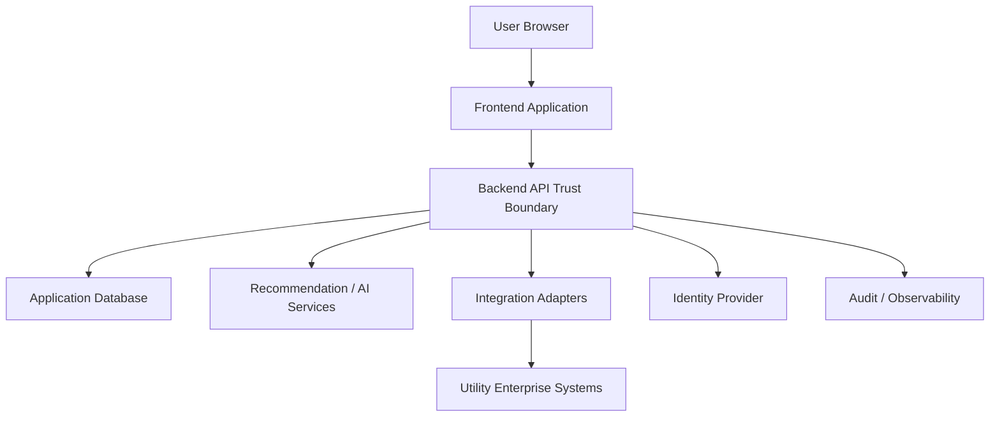

# Security Architecture

## Purpose

This document defines the security architecture direction for the AI Dispatch Advisor. It describes current proof-of-concept security posture, target enterprise controls, trust boundaries, sensitive data considerations, and production readiness gaps.

## Current Implementation State

The current Developer Bootstrap MVP is a local proof-of-concept. It includes:

- React frontend.
- FastAPI backend.
- Synthetic CSV data.
- Local SQLite initialization support.
- No production authentication.
- No role-based authorization.
- No live integrations.
- No production secrets.

The current POC must not be used as an operational dispatch system or connected to production utility systems without substantial security work.

## Security Goals

The security architecture should:

- Protect utility operational data.
- Enforce authenticated and authorized access.
- Preserve human accountability for dispatch decisions.
- Protect integration credentials and source-system boundaries.
- Prevent unauthorized writeback to systems of record.
- Preserve auditability of recommendations and user actions.
- Support enterprise security review and compliance processes.

## Trust Boundaries

The backend API is the primary enforcement boundary. The frontend should never be trusted to enforce operational permissions on its own.

## Security Control Areas

| Area | Target Control |
| --- | --- |
| Authentication | Enterprise identity provider integration |
| Authorization | Role-based access control enforced by backend |
| Secrets | Managed secret store, no credentials in source control |
| Transport | TLS for deployed environments |
| Audit | Durable audit events for recommendations and user actions |
| Integrations | Least-privilege adapter credentials and writeback governance |
| Data Protection | Sensitive data minimization and controlled access |
| Observability | Security-relevant logs without leaking secrets |

## Sensitive Data Categories

Potential sensitive data includes:

- Crew location.
- Crew identity or employee details.
- Customer outage information.
- Critical facility information.
- Grid asset and topology details.
- SCADA or DMS telemetry.
- Integration credentials.
- Recommendation and dispatch decision history.

The POC uses fictional data only. Production data classification must be completed before deployment.

## API Security Direction

Backend APIs should:

- Require authentication in non-local environments.
- Enforce role-based authorization.
- Validate all request payloads.
- Avoid exposing internal stack traces.
- Avoid logging secrets or sensitive payloads.
- Use correlation identifiers.
- Protect write operations with explicit permission checks.

## Integration Security Direction

Integration adapters should:

- Use least-privilege credentials.
- Keep credentials outside source control.
- Use secure transport.
- Restrict writeback operations.
- Log integration health and failures.
- Avoid exposing raw source-system payloads to untrusted clients.

## AI and Recommendation Security

AI and recommendation services should:

- Preserve human approval requirements.
- Avoid autonomous dispatch execution.
- Record recommendation inputs and outputs when persisted.
- Track model, prompt, and algorithm versions.
- Prevent Copilot text from becoming a command channel.
- Avoid exposing sensitive context beyond authorized roles.

## Current Security Gaps

Known gaps:

- No login or identity provider.
- No role enforcement.
- No production database security.
- No secrets management.
- No durable audit log.
- No integration credential model.
- No production TLS configuration.
- No vulnerability scanning workflow.
- No security review of dependencies or containers beyond basic local audit.

## Production Readiness Checklist

Before production use:

- Authentication implemented.
- Authorization model implemented.
- Audit event persistence implemented.
- Secrets management implemented.
- Integration credentials secured.
- TLS configured.
- Security logging reviewed.
- Sensitive data classification completed.
- Dependency and container scanning added.
- Threat model completed.
- Utility cybersecurity review completed.

## Related Documents

- [Identity and Access Management](802_Identity_and_Access_Management.md)
- [Audit Logging](803_Audit_Logging.md)
- [Observability](804_Observability.md)
- [Deployment and Operations](805_Deployment_and_Operations.md)
- [Business Continuity](806_Business_Continuity.md)

